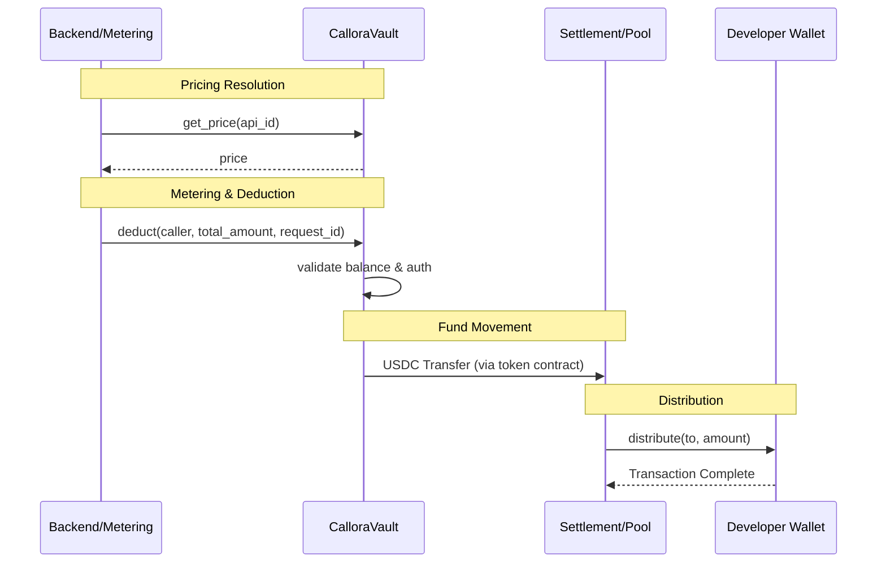

# Callora Contracts

Soroban smart contracts for the Callora API marketplace: prepaid vault (USDC) and balance deduction for pay-per-call settlement.

[](https://github.com/CalloraOrg/Callora-Contracts/actions/workflows/ci.yml)

## Tech stack

- **Rust** with **Soroban SDK** (Stellar)
- Contract compiles to WebAssembly and deploys to Stellar/Soroban
- Release WASM: vault ~63 KB, settlement ~62 KB, revenue pool ~34 KB

## Deployed contracts (testnet)

The core contracts are deployed and initialised on **Stellar testnet** (network passphrase `Test SDF Network ; September 2015`).

| Contract | Contract ID | Explorer |
|---|---|---|
| Vault (`callora-vault`) | `CBJZLUKQBWDMZPKNJAVONZ7GCCWADSETRXWOPN5Z3XWAUNI4F2R7XDYQ` | [stellar.expert](https://stellar.expert/explorer/testnet/contract/CBJZLUKQBWDMZPKNJAVONZ7GCCWADSETRXWOPN5Z3XWAUNI4F2R7XDYQ) |
| Settlement (`callora-settlement`) | `CB4BUGCX5LFS5KYWAO2J4ZQTALOQSGXFFAOVKKGAS32OFZLU7O7YYGHS` | [stellar.expert](https://stellar.expert/explorer/testnet/contract/CB4BUGCX5LFS5KYWAO2J4ZQTALOQSGXFFAOVKKGAS32OFZLU7O7YYGHS) |
| Revenue pool (`callora-revenue-pool`) | `CC5KINWRSLKSSQG4ZOTP3EZIOUVC6ER7HL5GZALYY4LVE6ZIMX4PMCSE` | [stellar.expert](https://stellar.expert/explorer/testnet/contract/CC5KINWRSLKSSQG4ZOTP3EZIOUVC6ER7HL5GZALYY4LVE6ZIMX4PMCSE) |
| Test USDC (Stellar asset contract, `USDC:GDXDZNST...WAZ`) | `CAC7CFZ42L3LTTZCI4C3XI6UF7AHS2PYTNJ5QEG2PSLRGDGMWRQOZOT5` | [stellar.expert](https://stellar.expert/explorer/testnet/contract/CAC7CFZ42L3LTTZCI4C3XI6UF7AHS2PYTNJ5QEG2PSLRGDGMWRQOZOT5) |

Full details, init parameters and smoke-test transactions are in [`docs/DEPLOYMENTS.md`](docs/DEPLOYMENTS.md). These are testnet-only demo deployments; the USDC is a self-issued test asset, not Circle USDC.

## Contract Quickstart

A minimal set of commands to build, test, and produce release WASM for the Soroban contracts in this workspace. Run them from the repository root.

**Prerequisites:** [Rust](https://rustup.rs/) (stable) with the `wasm32v1-none` target (`rustup target add wasm32v1-none`).

```bash
# 1. Format check
cargo fmt --all -- --check

# 2. Build and run the full test suite (this is what CI runs)
cargo test --workspace

# 3. Release WASM for the core contracts (Stellar CLI >= 23)
stellar contract build --package callora-vault
stellar contract build --package callora-settlement
stellar contract build --package callora-revenue-pool
#    ... or with plain cargo:
cargo build --release --target wasm32v1-none -p callora-vault -p callora-settlement -p callora-revenue-pool
```

Release artifacts land in `target/wasm32v1-none/release/<crate>.wasm`. The workspace crate names are `callora-vault`, `callora-revenue-pool`, and `callora-settlement` — pass the one you want via `-p`.

## What’s included

See [`docs/DISTRIBUTE_VS_REVENUE_POOL.md`](docs/DISTRIBUTE_VS_REVENUE_POOL.md) for the canonical payout contract, behavioural differences, and which contract `callora-freeze` protects.

### 1. `callora-vault`

The primary storage and metering contract. Holds USDC on behalf of API consumers and deducts balances on every metered call.

The catalogue below omits the Soroban `Env` argument. See the [vault contract interface](docs/interfaces/vault.json) for ABI types, return values, errors, and full signatures.

**Initialization and metering**

- `init(owner, usdc_token, initial_balance, authorized_caller, min_deposit, revenue_pool, max_deduct, settlement)` — Initialize the vault once; the last six configuration values are optional.
- `deposit(caller, amount)` — Owner or allowlisted depositor transfers USDC into the vault.
- `deduct(caller, amount, request_id)` — Authorized caller deducts one metered payment and routes it to settlement.
- `batch_deduct(caller, items)` — Authorized caller atomically processes `(amount, request_id)` items.

**Owner and pending-owner actions**

- `set_authorized_caller(new_caller, nonce)` — Owner-authorized rotation or removal of the deduction caller, protected by a nonce.
- `pause(caller)` / `unpause(caller)` — Owner-only direct circuit-breaker controls; both require the owner as `caller`.
- `withdraw(amount)` / `withdraw_to(to, amount)` — Owner-authorized recovery of tracked USDC; available while paused.
- `set_max_deduct(caller, max_deduct)` — Owner-only update of the per-deduction cap.
- `set_settlement(caller, settlement)` — Owner-only settlement-address update.
- `transfer_ownership(caller, new_owner)` / `accept_ownership()` — Two-step ownership transfer; acceptance is authorized by the pending owner.
- `prune_processed_requests(caller, ids)` — Owner-only removal of processed request markers.
- `add_address(caller, depositor)` / `clear_all(caller)` — Owner-only deposit-allowlist management.
- `set_reserve_cap(caller, token, cap)` — Owner-only inclusive reserve-cap update for the tracked USDC balance; other tokens are rejected.

**Admin and pending-admin actions**

- `distribute(caller, to, amount)` — Admin-only transfer of untracked USDC surplus; available while paused.
- `set_admin(caller, new_admin)` / `accept_admin()` — Two-step admin transfer; acceptance is authorized by the pending admin.
- `set_timelock_window(caller, window)` — Admin-only configuration of the critical-action timelock window.
- `set_admin_cooldown(caller, seconds)` — Admin-only configuration of the cooldown between critical executions.
- `admin_rescue(caller, token_address, to, amount)` — Admin-only rescue of accidental token transfers; tracked USDC remains protected.

The admin critical actions are timelocked. An admin first calls `propose_*`, waits until the proposal's `execute_after` timestamp, and then calls `execute_*`; `cancel_*` clears a pending proposal. Executing pause, upgrade, or sweep also observes the global admin cooldown.

- `propose_pause(caller)` / `execute_pause(caller)` / `cancel_pause(caller)`
- `propose_upgrade(caller, new_wasm_hash)` / `execute_upgrade(caller)` / `cancel_upgrade(caller)`
- `propose_sweep(caller, to, amount)` / `execute_sweep(caller)` / `cancel_sweep(caller)`

**Read-only views**

- `is_paused()`; `balance()`; `get_owner()`; `get_usdc_token()`; `get_max_deduct()`; `get_settlement()`; `get_revenue_pool()`
- `capabilities()` — Return the supported-feature bitmap.
- `get_timelock_window()`; `get_pending_pause()`; `get_pending_upgrade()`; `get_pending_sweep()`
- `get_admin()`; `get_admin_cooldown()`; `admin_cooldown_remaining()`; `is_admin_action_ready()`; `get_last_critical_admin_action()`
- `is_request_processed(request_id)`; `is_authorized_depositor(caller)`; `get_allowlist()`; `get_reserve_cap(token)`

## Architecture & Flow

The following diagram illustrates the interaction between the backend, the user's vault, and the settlement contracts during an API call.



## Local setup

1. **Prerequisites:**
   - [Rust](https://rustup.rs/) (stable)
   - [Stellar Soroban CLI](https://developers.stellar.org/docs/smart-contracts/getting-started/setup) (`cargo install soroban-cli`)

2. **Build and test:**

   ```bash
   cargo fmt --all
   cargo clippy --all-targets --all-features - -D warnings
   cargo build
   cargo test --workspace
   ```

3. **Build WASM:**

   ``bash
   # Build all publishable contract crates and verify their release WASM sizes
   ./scripts/check-wasm-size.sh

   # Or build a specific contract manually
   cargo build --target wasm32-unknown-unknown --release -p callora-vault
   ```

## Development

Use one branch per issue or feature. Run `cargo fmt --all` and `cargo test --workspace` before pushing, and make sure the core contracts still build to WASM (`cargo build --release --target wasm32v1-none -p callora-vault -p callora-settlement -p callora-revenue-pool`).

Some legacy tests that no longer match the current contract behaviour are marked `#[ignore]`; they are catalogued in [`docs/KNOWN_ISSUES.md`](docs/KNOWN_ISSUES.md).

## Project layout

```
Callora-Contracts/
├── .github/workflows/ci.yml   # CI: fmt check, workspace tests, WASM build
├── contracts/
│   ├── vault/                 # Prepaid USDC vault and metering (core)
│   ├── settlement/            # Developer balances / global pool accounting (core)
│   ├── revenue_pool/          # Revenue distribution pool (core)
│   └── ...                    # admin, escrow, refund, registry, stake, hot/cold, etc.
├── docs/
│   ├── DEPLOYMENTS.md         # Testnet deployment record
│   ├── KNOWN_ISSUES.md        # Ignored/removed legacy tests
│   ├── interfaces/            # JSON contract interface summaries
│   └── archive/               # Historical implementation notes and PR write-ups
├── scripts/                   # WASM size / event-shape / gas helper scripts
└── SECURITY.md                # Security checklist
```

## Contract interface summaries

Machine-readable JSON summaries of every public function and parameter for each contract are maintained under [`docs/interfaces/`](docs/interfaces/). They serve as the canonical reference for backend integrators using `@stellar/stellar-sdk`.

| File | Contract |
|------|----------|
| [`docs/interfaces/vault.json`](docs/interfaces/vault.json) | `callora-vault` |
| [`docs/interfaces/settlement.json`](docs/interfaces/settlement.json) | `callora-settlement` |
| [`docs/interfaces/revenue_pool.json`](docs/interfaces/revenue_pool.json) | `callora-revenue-pool` |

See [`docs/interfaces/README.md`](docs/interfaces/README.md) for the schema description and regeneration steps.

## Operator Guide

Backend operators setting up a new deployment should follow the step-by-step checklist in
[`docs/CONTRACT_ADDRESS_CONFIGURATION.md`](docs/CONTRACT_ADDRESS_CONFIGURATION.md).
It covers deploying and linking the USDC token, settlement contract, and revenue pool,
plus how to verify them with the vault's individual address view functions.

## Formal Verification (Kani)

The `callora-vault` crate ships bounded model-checking harnesses using [Kani](https://model-checking.github.io/kani/).
Harnesses are compiled only under `cargo kani` (gated with `#[cfg(kani)]`) and have zero impact on normal builds or `cargo test`.

### What is proved

| Harness | File | Property |
|---|---|---|
| `kani_deduct_balance_non_negative` | `src/kani_proofs.rs` | No underflow after a valid `deduct` call |
| `kani_deduct_strictly_reduces_balance` | `src/kani_proofs.rs` | `deduct` always strictly reduces the balance |
| `kani_deduct_request_id_transparent` | `src/kani_proofs.rs` | `request_id: u64` has no effect on balance arithmetic |
| `kani_deposit_no_overflow` | `src/kani_proofs.rs` | `deposit` never overflows `i128` for valid inputs |
| `kani_deposit_overflow_detected` | `src/kani_proofs.rs` | `checked_add` correctly detects overflow |
| `kani_max_deduct_enforced` | `src/kani_proofs.rs` | Guard rejects `amount > max_deduct` before touching balance |
| `kani_batch_deduct_total_no_overflow` | `src/kani_proofs.rs` | `batch_deduct` running-total over `Vec<(i128, u64)>` is sound |
| `kani_withdraw_balance_non_negative` | `src/kani_proofs.rs` | `withdraw` never underflows |
| `kani_deduct_conserves_total_supply` | `proofs/deduct.rs` | Successful `deduct` conserves the vault + settlement accounting total |
| `kani_deduct_request_id_conserves_total` | `proofs/deduct.rs` | Conservation invariant holds across all `request_id: u64` values |
| `kani_batch_deduct_conserves_total_supply` | `proofs/deduct.rs` | 2-item `batch_deduct` conserves the accounting total |

### Running locally

```bash
# Install Kani (one-time; ~300 MB)
cargo install --locked cargo-kani

# Run all vault harnesses
cargo kani -p callora-vault

# Run a single named harness
cargo kani -p callora-vault --harness kani_deduct_balance_non_negative
```

### CI workflow

The harnesses are not part of the default CI; run them manually with `cargo kani`.

### Module structure

```
contracts/vault/
├── src/
│   ├── kani_proofs.rs      # #[cfg(kani)] mod proofs — 8 pure arithmetic harnesses
│   └── lib.rs              # #[cfg(kani)] mod kani_proofs; declaration
└── proofs/
    └── deduct.rs           # DeductState model + 3 conservation harnesses + unit tests
                            # Included as mod deduct_proofs under #[cfg(any(kani, test))]
```

## Security Notes

- **Checked arithmetic**: All balance mutations use `checked_add` / `checked_sub` with explicit panics.
- **Input validation**: `amount > 0` enforced on all deposits and deductions.
- **Overflow checks**: Enabled in both dev and release profiles (`Cargo.toml`).
- \*\*Role-Based Access\*\**: Documented in [docs/ACCESS_CONTROL.md](docs/ACCESS_CONTROL.md).
- **Revenue pool admin audit trail**: `callora-revenue-pool` emits `admin_transfer_started` when an admin is nominated, and `admin_changed` with `(old_admin, new_admin)` only when the nominee accepts — a cancelled transfer emits no change event.
- **Dedup hardening**: Duplicate `get_max_deduct` declaration removed in `callora-vault`; allowed depositor duplicate-path test now asserts list cardinality.
- \*\*Emergency drain (Multisig + timelock)\*\*: `callora-revenue-pool` now exposes `propose_emergency_drain`, `execute_emergency_drain`, `cancel_emergency_drain`, and `get_pending_emergency_drain`. A proposal stores a `PendingEmergencyDrain` snapshot; execution is gated behind a 24-hour timelock (`EMERGENCY_DRAIN_TIMECLOCK_SECONDS = 86 400`). When the admin is a Stellar multisig account, `require_auth` enforces the native multi-signature threshold automatically.

See [SECURITY.md](SECURITY.md) for the full Vault Security Checklist and audit recommendations.

---

Part of [Callora](https://github.com/CalloraOrg).
...
